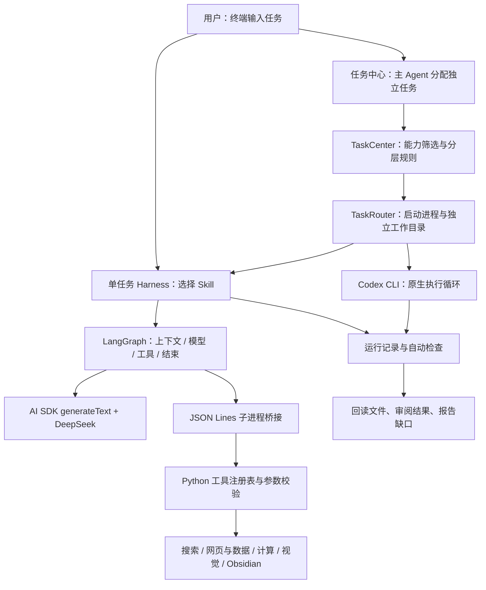

# Agent Harness：博客知识收集与任务编排

一个基于 **Python、TypeScript、DeepSeek、Vercel AI SDK 和 LangGraph** 的终端 Agent 工程原型。日常学习场景是用 OMP 的 `/collect` 保存简短文章卡片，由用户阅读、补充正文和关联，再由 `obsidian-study` Skill 按任务取用 Obsidian 笔记；统一任务入口还可以把独立工作分配给 DeepSeek Harness 或本机 Codex CLI，收回实际回答、文件和运行记录。

项目从手写 Agent Loop 演进而来，将工具、Skill、上下文维护、预算、调度和验收分开组织。DeepSeek 主 Agent 负责理解任务、提出分类并审阅结果；任务中心按能力、可用性和复杂度规则选择执行端，TaskRouter 负责启动进程、隔离目录、取消和回收产物。当前最多并发两项独立任务，DeepSeek失败后可在条件允许时升级到Codex一次。

当前所有本项目的Agent入口统一使用LangGraph内部循环；AI SDK仅负责单次模型请求与DeepSeek适配。Python手写循环及Vercel ToolLoopAgent实现已删除，历史验证报告已清理。定向阅读支持快照全文检索、原文回读、程序验收和可选独立模型核对，但没有证明新框架或额外核对能稳定改善成本与完成率。**模型结束、文件落盘、验收通过和事实正确分别判断，不将框架成功状态当作任务正确性的保证。**

统一交互入口：`cd vercel_agent && npm run person`。单任务入口：`npm run harness -- <skill> "任务"`，同样使用LangGraph；`harness:langgraph`保留为兼容别名。

## Obsidian 只读 MCP 与检索

FastMCP 服务向 Cursor 和 OMP 提供 `search_obsidian` 和 `read_obsidian`。参数复用原工具库的严格 Pydantic 模型；日常检索默认使用免费本地 Embedding 的向量检索；BM25 和混合检索＋重排序保留为可选方式。返回笔记路径和精确定位，正文与链接保持只读。日常学习库与独立验收库分开。OMP 的 `obsidian-study` 通过原生 MCP 连接先做向量检索，再按路径和 hash 读取笔记。

安装、Cursor 配置和检索对照见 [OBSIDIAN_MCP.md](docs/OBSIDIAN_MCP.md)。该功能扩展笔记取用能力，沿用现有 `/collect` 的文章卡片模式。

首次安装：

```sh
.venv/bin/python -m venv .venv-mcp
.venv-mcp/bin/python -m pip install -r requirements.txt -r requirements-mcp.txt
.venv-mcp/bin/python scripts/prepare_obsidian_models.py
.venv-mcp/bin/python scripts/install_obsidian_cursor.py
```

已有本项目的 Cursor 配置可运行 `.venv-mcp/bin/python scripts/install_obsidian_cursor.py --update-method` 更新日常默认值；仅修改检索方式，保留库路径和其他设置。请求省略 `method` 时使用服务默认值；传 `method: "bm25"` 或 `method: "hybrid"` 可选择关键词检索或混合重排序，`method: "vector"` 显式选择向量检索。服务也可用 `OBSIDIAN_RETRIEVAL_METHOD` 覆盖默认值。

固定验收集（11篇笔记、24个查询、每组重复3次、统一Top3）结果：

| 方法 | Recall@3 | MRR@3 | 热启动中位耗时 |
|---|---:|---:|---:|
| BM25 | 58.3% | 0.667 | 3.39ms |
| 向量 | 79.2% | 0.840 | 10.03ms |
| 混合＋重排序 | 81.2% | 0.917 | 206.37ms |

选择向量作为日常默认，兼顾本验收集的召回和延迟。混合重排序提高整体排名，也有个别问题退步；小样本不能代表所有个人笔记。模型冷启动和索引准备耗时另计。Cursor已实际完成搜索、读取与带链接回答，验收笔记保持不变。


## 能做什么

| 能力 | 实现与交付 |
| --- | --- |
| 日常文章收录 | OMP `/collect`：短预览生成待阅读卡片，保留来源；重复收录不改动用户正文和链接 |
| 学习库检索 | `obsidian-study` Skill 使用 OMP 原生 MCP 做向量检索和正文读取，区分自动简介与用户正文，回答附内部链接 |
| 共同概念图谱 | 博客CLI保存后建议共同概念，建立“博客→概念→博客”内部链接；同源分析版本合并为一个文章节点，保留关联依据 |
| 工具调用 | 共享九个业务工具，支持网页回查、计算、JSON/CSV 解析查询和图片理解；参数通过 Pydantic 校验 |
| Skill 驱动任务 | 显式加载本地 Skill，以同一套 Loop 执行网页阅读、计算核对、图表增长率等流程 |
| 多执行端编排 | 接入 DeepSeek Harness 与本机 Codex CLI，最多并发两项独立任务，支持取消、结果通知和受限失败升级 |
| 运行控制与观察 | 分别记录模型请求、工具尝试、耗时、tokens 和错误；保存任务上下文、日志、答案和文件清单 |
| 结果验收 | 核对实际来源、逐字引文、文件存在性与 SHA-256；语义正确性仍需人工或主 Agent 审阅 |

## 架构



- **Loop** 管理模型与工具反复交互；普通工具错误可返回模型，预算错误必须强制停止。
- **Skill** 描述流程、输出与失败处理。它提供指令，不自动赋予新工具能力。
- **Harness** 组织任务、上下文、预算、日志和交付检查；工具执行仍由共享注册表负责。
- **主 Agent** 根据用户目标填写能力类型、复杂度和验收条件，处理结果通知并回读审阅产物。
- **任务中心** 校验分类字段，在已注册且能力匹配的候选中按规则选择执行端，管理队列与最多一次失败升级。
- **TaskRouter** 接收已选定的执行端，创建工作目录、启动进程、执行超时/取消并收回结果；它不再独立分析任务。

DeepSeek主入口和执行端统一使用LangGraph；Codex CLI仍使用自身的执行循环和工具。主 Agent 的请求预算不能限制 Codex 内部全部用量；当前没有统一金额硬上限。

## 快速开始

推荐在 macOS/Linux 使用 Python 3.11+、Node.js 22+。模型调用需要 DeepSeek API key；Codex 仅在使用其执行端时需要安装并完成登录。Obsidian 用于查看笔记，写入本地 Markdown 不依赖 REST 插件。

### 1. 安装依赖

```sh
git clone https://github.com/ashyh123/agent-harness.git
cd agent-harness
python3 -m venv .venv
.venv/bin/python -m pip install -r requirements.txt
cp -n .env.example .env
cd vercel_agent
npm ci
```

仓库当前为私有，克隆需要有访问权限。

### 2. 配置模型

在**仓库根目录**的 `.env` 填写：

```dotenv
DEEPSEEK_API_KEY="你的 API key"
DEEPSEEK_MODEL="deepseek-flash"
VISION_MODEL="deepseek-flash"
```

可选配置 `MINIMAL_AGENT_OBSIDIAN_VAULT` 为专属笔记目录的绝对路径。默认使用 `~/Documents/Obsidian/Agent 博客阅读`。可用模型及视觉输入能力以你的服务账号为准。

SDK/Harness 入口自动读取 `.env`。该文件、依赖目录和原始运行记录已加入 `.gitignore`。

### 3. 跑一个小任务

以下命令均在 `vercel_agent` 目录执行：

```sh
# 列出 Skill，不调用模型
npm run harness -- --list

# 使用真实计算工具；预期结果为 56088
npm run harness -- calculation-audit "计算123乘456，展示工具结果。"

# 多轮工具对话，输入 /exit 退出
npm run chat
```

真实模型任务产生 API 用量。运行结果会打印任务目录、请求次数、工具次数与 tokens。

## 演示流程

日常使用 OMP 时，先按 [MCP 安装说明](docs/OBSIDIAN_MCP.md)准备 `.venv-mcp` 与本地模型，再在 `vercel_agent` 运行一次 `npm run omp:install-collect`，重新打开 OMP。此命令同时安装 `/collect`、原生 MCP 和 `obsidian-study`。输入 `/collect https://博客地址` 新建待阅读文章卡片，在 Obsidian 的“我的笔记”写心得、“相关笔记”加入内部链接。需要复用时输入 `/skill:obsidian-study 结合我的笔记回答当前任务`。重复收录保留整个已有卡片，包括改名后的正文和链接。使用与本机验收见 [OMP_COLLECT.md](vercel_agent/OMP_COLLECT.md)。

之前的深入分析与自动图谱入口仍保留： `cd vercel_agent && npm run blog -- "https://博客地址"`。保存成功后独立整理共同概念，额外用量单独显示。在Obsidian打开 `知识图谱/首页.md`，文章局部图谱深度设为2；全局图谱过滤 `path:"知识图谱"`。已有笔记可用 `npm run blog:index -- "/absolute/path/to/阅读笔记.md"` 补建关联。范围、保护机制及验收见 [OBSIDIAN_KNOWLEDGE.md](vercel_agent/OBSIDIAN_KNOWLEDGE.md)。

### 博客 → 简化分析 → Obsidian

```sh
# 采集三家厂商各一篇博客，分析指定范围，保存并检查实际笔记
npm run verify:obsidian -- 810836465
```

这个入口先真实采集网页，再把快照 ID 交给 `obsidian-blog-reader` Skill，读取 text 前 4000 字符并分析。它会调用模型、写入真实笔记，保存独立验证记录；**这条演示验证的是指定范围分析与收录，不是整篇长文通读。**

输出目录：

```text
~/Documents/Obsidian/Agent 博客阅读/
  阅读笔记/       简化内容、优化启发、逐字引文、来源与实际阅读范围
  提取原文/       网页提取文本快照

reports/obsidian-runs/<本次验证>/
  verification.json    运行状态、真实路径与文件检查
```

在 Obsidian 中打开上述 vault，核对笔记、原文链接和读取范围。用已有快照执行单篇任务：

```sh
npm run harness -- obsidian-blog-reader "处理 document_id <替换为实际快照ID>，简化分析并保存到Obsidian。"
```

快照 ID 来自实际 `read_webpage` 返回，不能直接使用其他机器报告中的 ID。直接提供博客 URL 也支持，但长文在当前预算下可能失败。

### 发布独立任务 → 执行 → 回收与审阅

```sh
# 统一对话入口；支持 /tasks、/cancel <任务ID>、/exit
npm run person

# 一次分配两项独立任务：需要可用的 Codex CLI
npm run person -- "同时处理两个独立任务：用计算工具求12乘13；让具备代码执行能力的Agent编写并运行JSON转CSV脚本。分别回读审阅，给出结果和实际文件路径。"
```

主 Agent 提交任务后，后台最多并发两项；程序验收通过后进入 `awaiting_review`，完成消息唤醒主入口，回读产物并提交审阅判断后才能成为 `completed / agent_reviewed`。

### 执行端如何分配

分配逻辑位于 [selectExecutor](vercel_agent/task_center.ts#L105)，分类指令位于 [task-coordinator Skill](skills/task-coordinator/SKILL.md)。主 Agent 调用 `submit_tasks`，填写 `capability`、`complexity`、可选 `route` 和验收条件；代码先筛选可用且能力匹配的候选，再执行以下规则：

| 条件 | 当前自动选择规则 |
| --- | --- |
| 明确指定 `route=deepseek` 或 `codex` | 遵循指定，仍检查可用性与能力；不匹配时报错 |
| `complexity=complex` 或 `capability=coding` | 优先 advanced，当前为 Codex |
| 其他 simple 任务 | 优先 routine，当前为 DeepSeek |
| 所需分层没有候选 | 使用剩余能力匹配候选中的第一个；没有候选则报错 |

DeepSeek 注册 general/web/data/math/image，Codex 还注册 coding。分类来自主模型，代码不会再次判断任务的真实复杂度；routine/advanced 是配置标签，不代表已验证的价格或成功率。需要编写脚本或任意文件的任务应分类为 coding/advanced，不能因为同属“数据处理”就假定DeepSeek已有对应工具。

执行、程序验收或主 Agent 审阅失败时，首次routine任务可升级到配置中的Codex：须能力匹配、可用、中心未关闭且剩余时间至少5秒。升级交接原目标、失败原因、已有回答与产物索引；advanced首次失败、第二次失败或取消不再升级。不根据历史成功率、实时价格或负载自适应路由。

启动时DeepSeek检查密钥配置，Codex检查CLI可执行文件；这不保证账号登录、额度或服务连接正常。

若需要手动指定执行端：

```sh
npm run router -- agents
npm run router -- run --agent codex "计算(123*456)+789，生成result.json和report.md。" --expect result.json --expect report.md
npm run router -- runs --limit 10
```

记录与产物存于 `~/Documents/Agent-Runs/`，按日期、执行端和任务 ID 分目录。取消与超时会终止相关进程树并保留已有产物。详细入口及状态见 [任务中心](vercel_agent/TASK_CENTER.md) 和 [TaskRouter](vercel_agent/ROUTER.md)。

## 验证方式

历史验证报告和运行日志已清理，保留测试代码与必要的输入资料。当前使用 LangGraph 循环、沿用原 Harness 策略；此前实验未证明迁移循环或加入 Jev 分类能稳定降低成本，也未解决所有长文阅读问题。

本地验证，从仓库根目录执行：

```sh
.venv/bin/python -m unittest discover -s tests -v
.venv/bin/python -m pip check
cd vercel_agent
npm test
npm run typecheck
```

真实 API 验证入口包括 `verify:search`、`verify:obsidian`、`verify:context`，会产生模型用量。部分预算与上下文对比脚本依赖 Git 忽略的本机快照/数据清单；克隆仓库后不能直接重放这些实验。新运行会重新生成本地记录，`reports/` 不进入 Git。

## 代码导航

从仓库根目录运行 `python3 vercel_agent/verify_hybrid_repeated.py --exclusive` 可新建三轮对照；需要配置 API key 和本机 Codex，会产生真实用量。旧的单轮分类实验入口和历史报告已移除。

| 位置 | 阅读重点 |
| --- | --- |
| [agent_config.py](agent_config.py)、[runtime.py](runtime.py) | 原提示词和默认预算、工具内模型用量与预算计数 |
| [tools.py](tools.py)、[tool_library/](tool_library/) | 工具定义、参数模型与共享执行器 |
| [execution_runtime.ts](vercel_agent/execution_runtime.ts)、[bridge.ts](vercel_agent/bridge.ts) | 计量HTTP适配、原上下文策略与Python子进程桥接；不包含独立循环 |
| [harness.ts](vercel_agent/harness.ts)、[skills/](skills/) | Skill 加载、任务隔离、运行结束与任务验收 |
| [person_cli.ts](vercel_agent/person_cli.ts)、[task-coordinator](skills/task-coordinator/SKILL.md) | 主Agent入口、分类指令、通知和产物审阅 |
| [task_center.ts](vercel_agent/task_center.ts)、[task_router.ts](vercel_agent/task_router.ts) | 能力筛选、分层路由、队列、取消、失败升级与产物回收 |
| [langgraph_loop.ts](vercel_agent/langgraph_loop.ts)、[reading_validation.ts](vercel_agent/reading_validation.ts) | 图内模型/工具循环、程序验收、可选核对及预算内修正 |
| [context.ts](vercel_agent/context.ts)、[working_context.ts](vercel_agent/working_context.ts)、[offload_context.ts](vercel_agent/offload_context.ts) | 默认摘要策略与两种实验策略 |
| [tests/](tests/)、[vercel_agent/tests/](vercel_agent/tests/) | 参数边界、故障注入、真实 SDK/桥接的离线集成测试 |

## 当前限制与下一步

- **长文证据保持仍不稳定。** 已解决的运行阻断不等于完成阅读任务；压缩/移出可能丢失关键事实与引文，模型可能重复回读并耗尽预算。默认仍为 `legacy`，未因局部实验结果切换。
- **网页提取不保证完整。** 当前读取公开 HTTP(S) 页面，不执行 JavaScript、不登录，也不支持 PDF 正文解析；提取快照不等于原始网页全部内容。
- **验收有边界。** 正确 hash、逐字引文和模型审阅都不保证解释正确。单任务 Harness 的 `needs_review`、任务中心的 `agent_reviewed` 均保留人工复核责任。
- **任务中心只管理自己创建的任务。** 目前注册两个执行端，没有自动接管其他会话、后台常驻、定时调度或崩溃恢复。

下一阶段聚焦稳定保存任务关键事实与逐字证据、降低原文定位和重复回读成本，并在固定验收集上比较成功率、用量与失败类型。

## 进一步阅读

- [工具参数、运行预算与扩展方式](docs/TOOLS_AND_RUNTIME.md)
- [SDK Loop 与上下文策略](vercel_agent/README.md)
- [Harness 与 Skill 的运行方式](vercel_agent/HARNESS.md)
- [任务中心](vercel_agent/TASK_CENTER.md) · [手动路由](vercel_agent/ROUTER.md)
- [手写阶段总结](LEARNING_SUMMARY.md) · [SDK/Harness 阶段总结](SDK_HARNESS_SUMMARY.md)

任务中心当前默认采用 **Jev 独占能力／复杂度分类**，DeepSeek 负责提交判断与结果审阅。需要配置 `TYPESAFE_API_KEY` 和 `DEEPSEEK_API_KEY`；可显式设置 `MINIMAL_AGENT_ROUTING_CLASSIFIER=baseline` 回到原方案。采用此版本不代表实验已证明降本。


### 旧深入分析入口：固定工作流与 Agent loop

```sh
npm --prefix vercel_agent run blog -- "https://www.anthropic.com/engineering/managed-agents"
# 需要自主回查、修正时显式使用 Agent loop
npm --prefix vercel_agent run blog:agent -- "https://www.anthropic.com/engineering/managed-agents"
```

实验命令 `blog`（`blog:workflow` 是同一工作流的显式入口）使用 `BlogWorkflow`，按 LangGraph 的固定路径 `read → summarize → validate → review_evidence → save` 执行。程序读取网页并从现有快照回读 text，模型生成 JSON 摘要，再用一次独立请求核对主要事实、关键限定、引文对核心结论的支持关系，以及启发是否标为推论；核对通过才调用原 Obsidian 保存工具。正常两次模型请求；HTML/Markdown 网页三次工具调用，纯文本两次，共享原预算；任何失败均停止，不自动切换到另一条路径。

`blog:agent` 使用 `BlogAgent → MinimalHarness → LangGraphLoop`，允许自主回查与修正。模型尝试保存时也执行同样的证据核对，未通过则返回原因供模型调整，拒绝的保存尝试仍计入工具预算。通用 LangGraphLoop 中的 `save_obsidian_blog` 也有此门槛，不能通过其他 Loop 入口跳过核对。直接调用 Python 工具只提供来源、引文匹配及落盘核验，不提供此模型审阅。

需要 `.env` 中的 `DEEPSEEK_API_KEY`；vault 由 `MINIMAL_AGENT_OBSIDIAN_VAULT` 配置，默认 `~/Documents/Obsidian/Agent 博客阅读`。每次处理一个 URL，写入 Markdown 笔记和提取原文。两条入口直接使用 DeepSeek，不经过 Jev 或任务中心，尚未自动注册为任务中心新执行端。

两种方式都是快速摘要，不保证通读全文。模型核对降低无关引文通过的风险，也可能误判；证据不足、核对输出无效、服务失败或预算耗尽时不保存，已有笔记不会被此次改动重新审阅或修改。之前的单请求工作流测试数据不代表加入核对后的成本。代码、边界及复测命令见 [BLOG_WORKFLOW.md](vercel_agent/BLOG_WORKFLOW.md)。

2026-10-11 的学习 Demo 验收已完成：固定流程采用候选编号复制引文，核对器返回具体结论映射与绝对说法依据。三篇冻结厂商博客各跑两次，六次实际保存及项目内原文复核均通过；五个故意错误的证据候选均被拒绝。这是已知样例的回归验收，不代表生产可靠性或优于其他框架。完成范围、复现方式和简历表述见 [BLOG_DEMO_RELEASE.md](docs/BLOG_DEMO_RELEASE.md)。
