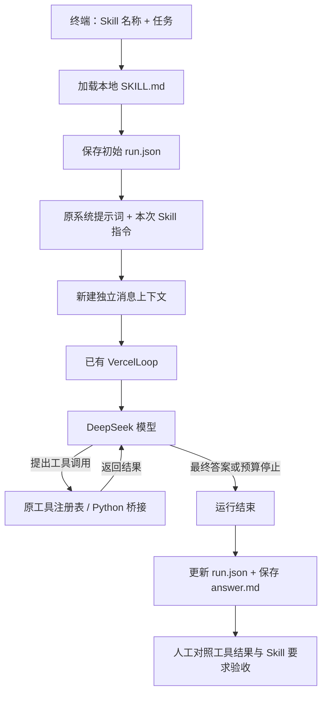

# 最薄 Harness：给现有 Loop 一个任务运行外壳

这个入口将“选择流程、执行任务、留下可验收结果”串起来。使用原来的 Vercel SDK Loop、DeepSeek 和四个 Python 工具；新增代码没有安装依赖。

## 先跑起来

在项目根目录运行：

```sh
cd vercel_agent
npm run harness -- --list
npm run harness -- calculation-audit "计算 123 乘以 456，列出工具核对步骤。"
npm run harness -- webpage-reader "读取 https://example.com/，说明页面用途以及原文没有提供的信息。"
```

列出 Skill 不读取密钥、不调用模型。执行任务自动读取根目录 `.env`，会产生 DeepSeek 用量。仍需已有 `.venv`、Node.js 22+ 和项目依赖。

每个任务有单独的目录：

```text
reports/harness/<skill名称>-<随机后缀>/
  answer.md    模型最终答案，或运行失败的原因
  run.json     任务、Skill 快照、预算配置、工具结果、模型用量和状态
```

运行记录已加入 `.gitignore`。它们包含任务与工具返回的资料；现有密钥脱敏继续生效。记录不覆盖上次任务，终端会打印本次绝对路径。

## 用到了什么

| 部分 | 文件 | 职责 |
| --- | --- | --- |
| 任务入口 | `harness_cli.ts` | 接收 Skill 名称与任务，加载环境、启动桥接、显示结果路径 |
| Skill 加载 | `skills.ts` | 读取本地 Markdown，检查名称与简单元数据 |
| 运行外壳 | `harness.ts` | 合并指令、建立独立上下文、调用 Loop、保存记录 |
| 工作流程 | 根目录 `skills/*/SKILL.md` | 描述步骤、输出格式及人工验收要求 |
| 模型与工具循环 | 已有 `agent.ts` | SDK 调度模型与工具，应用层限制预算并处理失败 |
| 工具执行 | 已有 `bridge.ts`、`tool_bridge.py`、`tools.py` | 复用 Python 注册表、参数校验与四个工具 |

## 一次任务怎样运作



例如计算任务：你选择 `calculation-audit` → Harness 读出“算术必须使用 calculate”等指令 → 模型提出乘法工具调用 → Python 返回 56088 → 下一次模型请求总结 → Harness 保存答案与调用记录。

Harness 不替模型决定工具顺序。Skill 描述预期流程，模型仍可能选错、跳过步骤或回答错误；硬性预算与参数检查继续由代码执行。

两个 Skill 都收到同一套四个工具。更换 Skill 改变工作流程和输出要求；它不会新增模型原本没有的操作能力，也不改变工具参数。

## 为什么先显式选 Skill

你先给出 Skill 名称，宿主程序才加载全文并交给模型。`--list` 的目录展示供人选择；当前不会让模型自动浏览、匹配或加载 Skill，也没有 `load_skill` 工具。

这让第一次实现可以直接检查“同一 Loop 和工具，换流程能否执行另一类任务”。自动选择可在需要时再加。此处使用本地、由开发者维护的 Skill；下载陌生 Skill 后直接运行不在当前流程里。

每个任务从新消息列表开始。跨任务记忆、多轮澄清及会话恢复尚未实现；资料不足时，本次答案说明缺口，你补充任务后重新执行。

## 运行结束和任务验收分开记录

| 情况 | runtime_status | task_verdict |
| --- | --- | --- |
| 已保存任务，尚未收尾 | `running` | `not_completed` |
| Loop 返回完整非空文本且没有运行错误 | `completed` | `needs_review` |
| 预算停止、模型/桥接失败等 | `failed` | `not_completed` |

`completed` 只表示运行正常结束。即使模型没有调用应使用的工具，或结论与证据矛盾，也不会自动标成任务通过。当前没有自动语义验收器。

打开 `answer.md` 看交付物，再打开 `run.json` 对照实际工具输入和输出，按保存的 Skill 人工验收。网页任务重点核对覆盖范围、引文、事实限定与来源；计算任务核对算式、单位和每一步结果。

请求前先保存 `run.json`。如果进程中途终止，初始记录仍显示 `running`，`finished_at` 为空；这不是成功结果。宿主的写盘失败会让入口报错，不保证崩溃或磁盘故障下两个文件能一起落盘。

## 阅读顺序与扩展入口

1. `skills/calculation-audit/SKILL.md`：流程如何写成指令。
2. `harness_cli.ts`：输入如何进入程序。
3. `harness.ts` 的 `run()`：加载、执行、保存的完整路径。
4. `agent.ts` 的 `generate()`：继续沿用之前读过的 Loop。
5. 本次 `run.json`：核对代码预期与实际执行是否一致。

要新增流程，只需创建根目录 `skills/<name>/SKILL.md`。当前格式刻意只支持下面的两个单行字段，按此顺序编写，不支持完整 YAML 或任意 Skill 标准字段：

```markdown
---
name: example-workflow
description: 这个流程用于什么任务。
---

流程步骤、输出要求、资料不足的处理方式、人工验收清单。
```

目录名必须等于 `name`，只用小写字母开头及小写字母、数字、连字符。Skill 全文和工具结果一样会占上下文，当前没有压缩 Skill 或动态工具加载。

下一次拓展应从实际失败出发：缺少操作能力就加工具；流程不稳定就调整 Skill；人工反复核对同一条件，就把可确定检查的部分提取为验收器。

## 验证

```sh
npm run typecheck
npm test
```

新增 Harness 验证使用真实 SDK 和真实 Python 计算工具，模型 HTTP 响应为离线模拟：检查两种 Skill 的指令隔离与工具复用、结果独立保存、预算停止证据、桥接中断记录，以及无效输入在模型请求前被拒绝。测试不读取 `.env` 或访问模型服务；它不能证明真实模型一定服从 Skill。

2026-10-07 本次验证：类型检查通过，全部 21 项测试通过（其中 4 项是新增 Harness 验证）。另外执行了两次真实任务：

| Skill | 模型请求 | 工具调用 | 总 tokens | 人工观察 |
| --- | --- | --- | --- | --- |
| calculation-audit | 2 | 1 | 2396 | 乘法工具返回 56088，答案一致 |
| webpage-reader | 2 | 1 | 2651 | 两段引文与读回原文一致，但答案额外说“仅一句话”，实际正文有两句话 |

合计 5047 tokens。这两次都正常落盘，状态仍为 `needs_review`；网页结果说明真实模型可以遵循主流程，同时产生局部事实错误。没有重跑或修改生成答案来掩盖这个问题。
