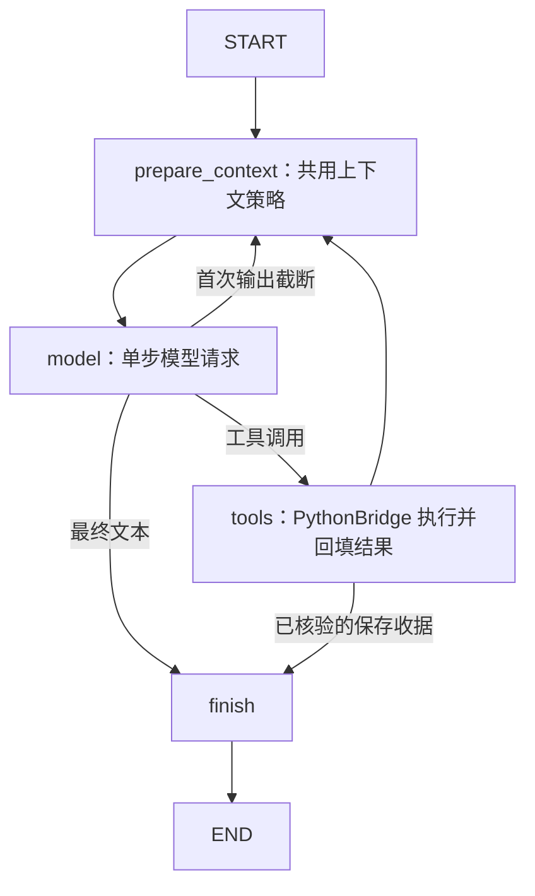
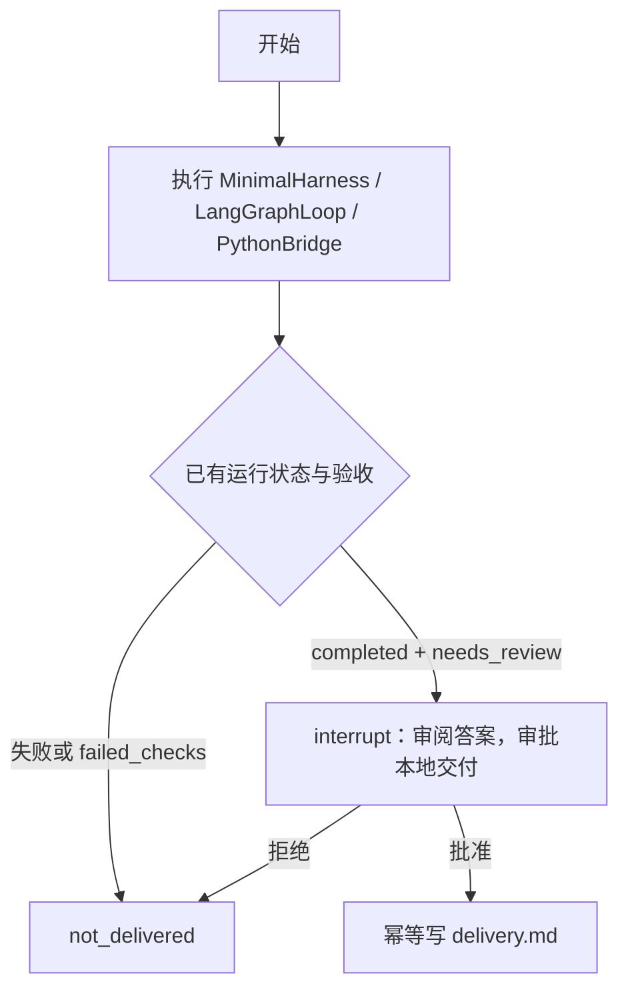

# LangGraph：内部执行循环与外层任务阶段

## 默认内部循环（2026-10-11迁移）

chat、MinimalHarness、person主Agent、TaskRouter的DeepSeek执行端均使用LangGraphLoop。原Python手写循环与Vercel ToolLoopAgent实现已删除；不保留双后端选择。原提示词和默认预算移至agent_config.py，原上下文与HTTP计量移至execution_runtime.ts。默认仍为legacy策略、原入口预算和Skill验收，不自动开启独立核对。Codex CLI的原生循环不变。

迁移是统一实现的工程选择，并非实验已证明更优。下文对照数字为迁移前记录；依赖旧循环的compare、verify:execution-graph、verify:evidence-reading脚本已移除，可在Git提交246b5e7查看。

## 直接执行模型与工具的循环

### 按问题检索、验收与自动修正

传入阅读约定后，模型最终输出会先进入 `validate`，核对完整JSON、问题ID、来源和实际回读引文；通过后进入 `critic`，用同模型的独立上下文核对证据与答案。任一阶段否决时回到原循环修正，所有核对与修正仍占原预算。没有约定时不启用这两个节点。

```sh
npm run harness:langgraph -- --contract examples/blog-questions.json webpage-reader '根据约定回答问题'
# 只保留程序验收与自动修正，关闭独立模型核对
npm run harness:langgraph -- --no-critic --contract examples/blog-questions.json webpage-reader '根据约定回答问题'
```

约定只含文档ID、来源、问题及引文长度，不含标准答案。示例依赖本机已有博客快照；CLI收窄为快照检索与回读两种工具，保留默认预算。FTS5/BM25检索无需embedding或密钥。

`--no-critic` 对应任务输入的 `readingReview: "structural"`：validate通过后直接进入finish；默认仍为semantic。来源、逐字引文、格式和问题覆盖检查保持，但程序不判断引文是否支持答案，语义仍需人工核对。运行记录保存reading_review，工具与模型请求轨迹可核对是否实际跳过critic。

新增36次同批三组消融：原Harness严格9/12，程序验收8/12，程序验收＋模型核对人工复核后9/12。关闭核对总体tokens仅下降1.80%，博客组反而增加1.90%，未证明保持完成效果并节省预算；当时默认未切换，此次按项目选择统一内部循环。见[三组消融报告](../reports/evidence-ablation-validation.md)。

24次真实对照，自动严格通过8/12→11/12，人工复核8/12→10/12，总tokens增加50.26%。独立核对漏判了一次恢复步骤顺序错误，另有一次格式修正耗尽预算。该结论来自迁移前可选入口；见[完整结果与边界](../reports/evidence-reading-validation.md)。

`npm run harness:langgraph` 通过 `langgraph_loop.ts` 的 StateGraph 执行任务。图节点分别准备上下文、请求一次模型、执行工具、结束；模型提出工具调用后，图负责把对应结果加入上下文并继续请求。模型节点使用 AI SDK 的 `generateText` 适配 DeepSeek，但不使用 `ToolLoopAgent`，也不调用原 `VercelLoop`。工具执行只发生在图的 tools 节点。



```sh
npm run harness:langgraph -- --list
npm run harness:langgraph -- webpage-reader '阅读指定网页并核对来源'
# 真实模型评测，需要本机已有的两份固定博客快照
npm run chat -- "使用calculate计算123乘456"
```

两种内部循环共用预算、工具、上下文维护、Skill 和日志。24次真实博客/JSON/CSV实验，两组均严格通过6/12，LangGraph总tokens多8.68%，没有证明更优；该结果不证明本次统一迁移具有性能收益。详见[内部执行对照报告](../reports/langgraph-execution-validation.md)。图内有节点轨迹，但没有接入checkpointer，不支持模型步/工具步的进程崩溃恢复。

## 外层任务阶段执行后端

`npm run harness`使用默认LangGraph内部循环。选择 `npm run langgraph` 则由 TypeScript LangGraph 编排同一个 MinimalHarness：执行、验收分支、人工审批、交付。外层图与默认内部LangGraph循环分工不同，没有重写Python工具。v1 只支持现有 calculation-audit Skill，并把可用工具收窄为 calculate；没有 Obsidian、委派或网络副作用。



状态包括固定任务、完整 Harness 结果（含配置、工具轨迹、用量和验收）、审批决定、阶段状态。SQLite 使用本地持久 checkpointer，每个目录对应一个固定 thread_id。执行器的模型请求、工具次数、输出与时间预算原样沿用；暂停后的恢复只处理审批/交付，不重新开一份执行预算。审批暂停时间不占执行器运行预算。

## 运行与重启

在 vercel_agent 执行，安装依赖：`npm ci`。使用已配置的 DeepSeek 账号开始任务会产生模型用量；初轮为离线测试；随后已在用户授权下完成 12 轮真实 DeepSeek 验证，详见验证报告。

```sh
# 旧执行入口
npm run harness -- calculation-audit '计算123乘456'
# 新后端：使用一个新的本地目录，执行后停在审批处
npm run langgraph -- start ../reports/langgraph-runs/my-calculation '计算123乘456'
# 上一进程已退出；状态读取和审批恢复不需要模型凭据
npm run langgraph -- status ../reports/langgraph-runs/my-calculation
npm run langgraph -- resume ../reports/langgraph-runs/my-calculation approve
# 或拒绝，便不会写 delivery.md
# npm run langgraph -- resume ../reports/langgraph-runs/my-calculation reject
```

查看 interrupt 中的实际答案及 `harness/*/run.json` 后再批准。审批只授权 `delivery.md`，前面的运行记录本来就是 Harness 的证据保存；不是对模型语义正确性的自动认证。已有 Skill 验收只能否决，`needs_review` 的责任保持。calculation-audit 没有新增通用语义评分器；对照评测使用独立固定算式的数值和工具证据检查。

## 恢复边界

- **执行完成后保存 execution.json，随后图提交检查点。** 若两者之间进程退出，恢复节点读回同一结果，不重新调用执行器。
- **审批节点无副作用。** `interrupt` 恢复会重进节点，写交付放在批准后的独立节点。
- **交付与图检查点之间退出。** 再执行交付节点时核对已有文件内容；相同则复用，不再写入，不追加。如果内容不同则报冲突，保留原文件。
- **执行器内部退出。** execution.started 存在而没有完整执行结果时，拒绝自动重跑。需人工检查 Harness 记录；不自动删除 marker 或重置预算。本版本没有模型步/工具步级恢复，没有 TaskCenter 队列崩溃恢复。

每个目录只能由一个本地调用者操作。不支持并发恢复、外部 API exactly-once、数据库/文件跨资源事务、主机断电或损坏数据库恢复。SQLite 与原子 rename 验证的是本机进程退出边界。运行目录含任务和完整证据，已加入 Git 忽略；不要上传。未接入 LangSmith，检测到环境显式开启 tracing 会拒绝运行。

## 离线验证与对照

```sh
node --import tsx --test tests/langgraph.test.ts
npm run verify:langgraph
# 明确的付费模型验证入口，使用已配置的 DeepSeek 账号
npm run verify:langgraph:real
npm run typecheck
npm test
```

离线模型响应固定，**真实 Vercel SDK、真实 PythonBridge 和 calculate** 执行；不读取 .env、不调用模型 API。故障测试用独立 Node 进程 `process.exit(73)`，另起进程从 SQLite 恢复，核对只存在一次 Harness 运行、两次模拟模型请求、一次真实工具调用，交付内容无重复。另测原预算失败、拒绝审批、已有验收否决、重复 start、执行结果不确定与禁止副作用 Skill。

对照复用相同 Skill、任务、calculate、配置和输出，正常预算/一请求故意失败档各重复三次，交替两组执行顺序。每次保存独立 Harness 记录和 comparison.json；记录实际执行耗时、工具轨迹、重复调用、模拟 tokens。评测脚本中的自动批准仅用于受控计算实验；真实交互入口仍需显式 approve/reject。成本记为 null，fixture tokens 不是计费证据。评测脚本不是通用算式评测，也不能说明真实模型稳定性。

结果及简历描述见 [验证报告](../reports/langgraph-validation.md)。原长文 offload-recovery 严格验收仍为 0/4，本任务不改变该结论。

参考：LangGraph 官方 [持久化](https://docs.langchain.com/oss/javascript/langgraph/persistence) 和 [interrupt 恢复语义](https://docs.langchain.com/oss/javascript/langgraph/interrupts)。本地依赖固定为 @langchain/langgraph 1.4.21、SQLite checkpointer 1.0.4；LangChain core 是框架依赖，没有宣称实现了 LangChain Agent 或迁移模型 provider。

## 统一迁移验收（2026-10-11）

- 126项TypeScript测试、76项Python测试通过，类型检查通过。数量变化来自删除旧Python循环专项测试及重复的旧SDK循环测试；上下文、预算、非法参数修正、结果复用、Obsidian保存、任务中心及LangGraph测试继续运行。
- 默认MinimalHarness集成测试检查实际graph_nodes为prepare_context/model/tools/prepare_context/model/finish，context_policy为legacy，没有隐式reading_critic请求。
- 真实CLI任务：`npm run harness -- calculation-audit '请使用calculate计算123乘456，简短回答。'`实际返回56088，2次模型请求、1次工具调用、7684 tokens；原Skill语义验收仍为needs_review，未冒充事实自动认证。
- 修复图循环丢失Pydantic字段错误的兼容问题：invalid_tool在预算内计一次失败，并返回不含原始输入的字段诊断，原数据可复用、参数可修正。
- 此次未重跑复杂任务36次对照，不把单项冒烟验收描述为完成率提升。已有实验报告保持历史数据。

运行命令保持`npm run person`、`npm run harness`、`npm run chat`。已启动的旧进程须退出后重新启动才能加载新循环。
