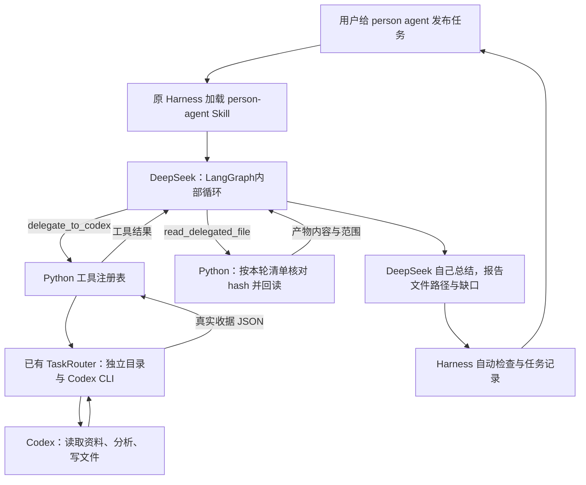

# DeepSeek 的 person agent：委派 Codex，收回并审阅文件

这个入口让现有 DeepSeek 模型自己提出委派工具调用。Codex 执行后，收据成为 DeepSeek 的工具结果；DeepSeek 再决定回读哪些产物并给出自己的总结。没有重写 LangGraph Agent Loop，没有新增包依赖。

## 运行

在项目根目录进入 SDK 目录：

```sh
cd vercel_agent
npm run person:delegate -- "把 https://www.anthropic.com/engineering/managed-agents 交给 Codex 阅读分析；生成来源、证据和 Obsidian 笔记，你再回读审阅并总结。"
```

`person:delegate` 等价于经由路由器运行 `harness` 执行端和 `person-agent` Skill，外层执行超时为 420 秒。使用项目 `.env` 中的 DeepSeek 配置，以及本机 Codex 的现有登录和模型配置。也可使用 `npm run harness -- person-agent "任务"`；这个直接入口的父运行记录仍在项目 `reports/harness`，子任务使用路由器配置的根目录。

`npm run person:delegate` 的父任务保存在 `~/Documents/Agent-Runs/harness/<日期>/<任务ID>/`。Codex 的子任务位于父任务 `workspace/delegated/codex/<日期>/<子任务ID>/`。你可以在 Obsidian 打开子任务 `workspace/obsidian`，查看它实际写入的笔记；没有自动合并到其他 vault。

## 两个新增工具

| 工具 | 输入 | 返回/约束 |
| --- | --- | --- |
| `delegate_to_codex` | 简短任务、期望文件相对路径、可选超时 | Codex 的真实执行状态、task_id、文件清单、工作目录、回答和单独的用量；每个父任务最多启动一次 |
| `read_delegated_file` | 本轮 task_id、产物相对路径、offset/limit | UTF-8 文件片段、实际路径、SHA-256 验证及分页位置；不读取任意路径、旧任务或符号链接 |

两个工具在 Python 注册表中按 `person-agent` profile 启用，其余入口仍默认八个工具。Person profile 共十个工具，DeepSeek 可以按任务需要使用原有工具。委派的执行端当前固定为 Codex；没有自动发现或接入电脑上其他 Agent。

相同参数的重复委派返回本轮已有收据，不重跑 Codex，仍计入父工具调用次数。第一次尝试失败也不允许换参数再启动；用失败收据说明缺口。这个缓存只属于当前父运行，不是跨任务的会话恢复。

回读前检查文件在本轮产物清单中，再逐层打开且不跟随符号链接。核对内容 hash 和字节数后，最多按字符返回 6000 字，单文件限 1 MiB。文件被改动、不是 UTF-8、超过范围或不在清单中时明确返回错误。压缩记录保留 task_id、文件索引、hash 和阅读位置，后续回查不会重新启动子任务。

## 一次请求的实际调用链



“委派”仍是一次工具调用：外层模型看到工具描述，返回名称、参数、tool_call_id；LangGraph的tools节点执行工具并把结果交回下一次模型请求。不同之处在于这个工具内部运行了另一个 Agent，内部模型循环由 Codex 管理。不能把一次委派说成一次 Codex 模型请求。

## 预算和验收边界

Person profile 保留外层五步、父模型总请求八次、工具八次和每次输出 512 tokens。委派可能超过旧 90 秒，所以父时间上限设为 360 秒；子任务默认 180 秒、输入上限 300 秒，并按父任务剩余时间减去 30 秒缩短，给最终总结留时间。最外层路由器用 420 秒收尾。父任务取消或超时会清理嵌套进程；子 Agent 不在父任务结束后继续后台工作。

第一次真实执行在委派、回读后失败：新增工具描述和子任务索引已超过旧压缩目标的可用空间。Person profile 因此使用 24000 的压缩触发阈值、16000 的目标容量，沿用原 `legacy` 算法和 64000 本地安全容量；这些均为保守估算，并非模型实际 tokenizer。原有其他入口的上下文配置没有改变。

父模型用量在原 `RunResult` 中计数；Codex 原生用量在委派收据及路由记录 `usage.delegated` 中单列。共享父任务的时间约束，并不意味着 Codex 内部请求次数也受 DeepSeek 的八次上限约束；此版没有对外部 CLI 的 token 硬上限。不能把缓存输入再加到原生输入统计上。

自动检查可否决：没有成功委派、没有回读实际产物、或者未给真实文件路径，均不能通过。检查通过仍为 `needs_review`；它证明调用链和文件边界成立，不证明子 Agent 引文正确或父模型语义审阅可靠。父 Agent 只回读了笔记时，不能声称自己独立读取了原网页。

## 阅读代码

1. `skills/person-agent/SKILL.md`：定义父 Agent 的委派、回读和汇报流程。
2. `person_profile.ts`、`router_worker.ts`：为这个流程启用工具、配置容量，并建立本次子任务目录。
3. 根目录 `tools.py` 的 `DELEGATION_TOOL_REGISTRY`：给 DeepSeek 的两个工具 Schema，仍使用 Pydantic 参数校验。
4. `tool_library/delegation.py`：任务经 stdin 传给已有路由器；收到真实收据后绑定本轮文件清单，提供回读。
5. `router_cli.ts` 的 `--json`、`--task-file -`：让工具与路由器交换结构化结果，避免解析终端说明文字。
6. 原有 `agent.ts`：循环机制没有改；`context.ts` 仅增加子任务资料的索引保留，`checks.ts` 增加父流程的检查。

本地测试使用离线模型响应和假 Codex CLI；真实验收另行调用两个模型，记录成功与失败。
