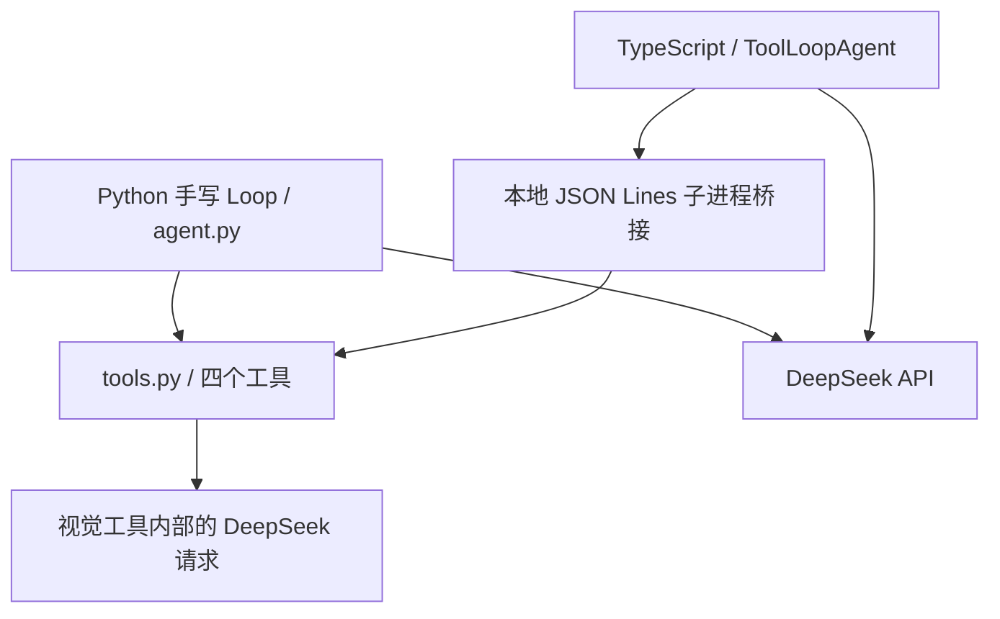

# 用同一套工具比较两个 Agent Loop

这是现有 Demo 的第二个入口。`agent.py` 保留手写循环；这里由 Vercel AI SDK 的 `ToolLoopAgent` 接管模型请求、工具分发、结果消息与继续循环。两个入口共用 DeepSeek、系统提示词、四个工具及预算，没有替换原实现。

## 运行

前提：Node.js 22+，项目根目录的 `.venv` 已安装 `requirements.txt`，`.env` 已填写 `DEEPSEEK_API_KEY`。默认主模型 `deepseek-flash`，视觉模型沿用原来的 `VISION_MODEL` 配置。

在项目根目录执行：

```sh
cd vercel_agent
npm ci
npm run chat
```

输入 `/exit` 退出；也可以一次运行一个任务：

```sh
npm run chat -- '请使用计算工具算出 123 乘以 456，简短回答。'
npm run chat -- '阅读 images/demo-chart.png，然后使用计算工具算出增长百分比。'
```

自动读取根目录 `.env`。直接使用 DeepSeek provider，不需要 Vercel 账号、AI Gateway 密钥或部署服务器。最近一轮记录保存在 `reports/vercel-last-run.json`，每轮覆盖；密钥和认证头不记录。

## 代码分工

现在也可以通过 [最薄 Harness](HARNESS.md) 显式选择本地 Skill 执行独立任务：`npm run harness -- --list` 查看流程，`npm run harness -- calculation-audit "计算 123 乘以 456"` 运行。复用以下 Loop 和工具，每次保存独立答案与运行记录；模型正常结束后仍需人工验收。



| 文件 | 职责 |
| --- | --- |
| `agent.ts` | 配置 `ToolLoopAgent`，保留应用层预算、截断恢复与成功历史提交 |
| `bridge.ts` | 启动本地 Python 子进程，用 JSON Lines 请求/响应传递数据 |
| `tool_bridge.py` | 导出原工具描述和 JSON Schema，使用原 Pydantic 校验、`execute_tool` 和 `RunContext` |
| `cli.ts` | 多轮终端对话、失败回滚、最近一轮记录 |
| `compare.ts` | 相同配置的两版实测，保存每组运行证据 |
| `tests/loop.test.ts` | 真实 SDK + 模拟模型 HTTP 响应 + 真实 Python 工具桥接的离线验证 |

阅读顺序：`tool_bridge.py` 的 `describe` → `agent.ts` 的 `tools` → `makeAgent()` → `generate()`。这里没有再写一个 `while tool_calls`：SDK 负责运行工具，把工具结果按调用 ID 写入消息，并按停止条件继续请求。

桥接是为了让 TypeScript SDK 使用同一份 Python 工具，而不是重新实现四个工具。它是本地子进程协议，不是 MCP，也没有 HTTP 服务。日常 CLI 真实访问搜索和网页；图片仍由 Python 的视觉工具调用原来的模型接口。

## 保持一致的应用策略

两版都限制每轮 5 次外层模型请求、8 次模型总请求（含视觉）、8 次工具尝试和 90 秒步骤启动预算；主模型每次最多输出 512 tokens，模型请求最多等待 30 秒，并按剩余时间缩短。与原版一样，总耗时不是强制杀掉进行中的工具请求。

SDK 的默认 20 步、2 次失败重试调整为 5 步、0 次重试，工具顺序也显式沿用原注册表。每一次实际 HTTP 模型请求都会进入 Python 的共享预算；视觉工具也使用同一个 `RunContext`。

单轮可通过 `agent.run(messages, { maxRetries: 1 })` 开启一次 SDK 原生模型请求重试；CLI 和对比脚本未传该选项，仍默认 0。重试复用当前步骤的请求消息，包括已有工具结果，不重启整个 Loop，也不会重新执行前一步已成功的工具。每次实际请求尝试仍占共享预算。HTTP 503 等可重试接口错误会走这条路径；当前本地 `AbortSignal.timeout()` 的 `TimeoutError` 不会触发 SDK 原生重试。离线证据见 [重试验证](../reports/vercel-sdk-retry-validation.md)。

SDK 在执行前使用桥接的 Pydantic 校验；校验失败或未知工具生成 SDK 错误结果，仍计入工具尝试次数。正常工具错误（如除零）沿用原工具返回格式，交由模型解释。预算错误则必须终止任务，不能让模型把它当成可继续的业务错误。

SDK 通常将执行异常转换为工具结果，观察回调的异常也不会中断生成。因此这里记录预算失败，并在 `prepareStep`、实际模型请求前和生成结束后检查，确保不会因为异常被 SDK 吞掉而继续花费预算。

512 token 截断后的自动精简是本项目自己的策略：丢弃半截输出/参数，复用已成功完成的步骤和原问题，加入临时恢复指令，再调用一次 SDK。它仍占用原预算；重试失败则明确报告未完成。只有成功才把本轮生成的消息提交到历史，恢复指令不进入下一轮。

SDK 可调度并行工具，本项目的 Python 桥接逐条执行请求，因此本次没有获得工具并发提速。更换 SDK 也不会自动验证来源或答案正确性。

## 对比与验证

真实模型对比会产生 DeepSeek 用量：

```sh
npm run compare
npm run compare -- '精确计算'
```

默认五组：精确计算、工具错误、网页搜索、指定网页总结、看图后计算。输出为根目录 `reports/vercel-sdk-comparison.json`，每个入口完成后即保存。指定单组运行会覆盖该报告，请先保留需要的旧记录。

评估先真实抓取一次指定网页和一次 DuckDuckGo 搜索，两版收到相同的工具返回。评估重放时忽略具体查询措辞，搜索结果固定为该次抓取的内容，目的是控制资料差异；这不是两次独立实时搜索的性能评测。计算与视觉仍正常执行，视觉输出可能因模型采样不同而变化。两版请求先后顺序按场景交替，没有锁定模型随机种子，因此不能把单次差异归因于 SDK。

详细结果与人工验收见 [对比报告](../reports/vercel-sdk-comparison.md)。

验证指定网页事实表（真实模型调用，会产生用量）：

```sh
npm run verify:webpage
npm run verify:webpage -- --clarify-history
```

两轮使用同样的五主题验收标准，后一轮只澄清“历史”指存储本身的历史。分别保存到 `reports/module-6-3-sdk-facts.json` 和 `reports/module-6-3-sdk-facts-clarified.json`，重新运行会覆盖对应记录。脚本检查工具读取、表格、来源 URL 和引文匹配（忽略空白、不忽略标点）；语义正确性与覆盖完整性仍需人工判断。运行时 `manual_review` 标记待核对，本次人工验收见 [事实表验证](../reports/module-6-3-sdk-facts-evaluation.md)。

离线验证不访问模型或搜索服务，不读取 `.env`：

```sh
npm test
npm run typecheck
```

原 Python 测试在项目根目录运行：

```sh
.venv/bin/python -m unittest discover -s tests -v
```

## 版本和参考

依赖版本与 `package-lock.json` 固定：`ai@7.0.130`、`@ai-sdk/deepseek@3.0.61`，核对日期 2026-10-07。

- [ToolLoopAgent 参数与默认值](https://ai-sdk.dev/docs/reference/ai-sdk-core/tool-loop-agent)
- [循环控制与停止条件](https://ai-sdk.dev/docs/agents/loop-control)
- [DeepSeek provider](https://ai-sdk.dev/providers/ai-sdk-providers/deepseek)

当前代码只使用非流式生成，便于和原版比较。流式 UI、工具审批、持久化历史等可在之后有具体需求时再引入。
