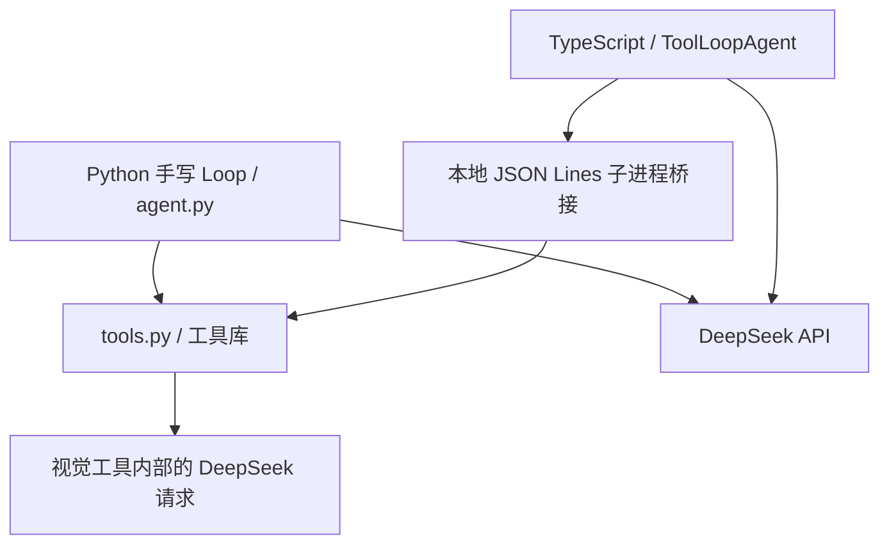

# Agent 工程实验与 OMP 学习入口

日常收录使用 OMP `/collect URL`：最多1800字符的短预览、一次简介请求、保存待阅读文章卡片。正文和关联由用户维护，重复收录保持原样。`/skill:obsidian-study 任务` 使用原生搜索和读取工具取用 Obsidian。安装与验收见 [OMP_COLLECT.md](OMP_COLLECT.md)。下方 LangGraph 与预算对照是保留的工程实验入口。

本项目的chat、Harness、主Agent及DeepSeek执行端统一使用`LangGraphLoop`。原Python循环和Vercel ToolLoopAgent实现已移除；AI SDK仅负责单次非流式模型请求。上下文默认legacy、提示词、预算、工具、Skill、任务记录和产物检查沿用原Harness。Codex委派端保持自身原生循环。

`npm run person`启动统一任务中心，`npm run harness -- <skill> "任务"`执行单项任务，`npm run chat`进行工具对话。`harness:langgraph`是兼容别名，不再选择后端。阅读约定及critic仍需显式使用`--contract`；不传时不会加入额外模型核对。

此前SDK/手写/图循环的对照为历史实验，结果与迁移后的默认行为分开；旧实现已删除，相关比较脚本不再提供，需在Git提交`246b5e7`查看原实现。详细流程和可选阅读验收见[LANGGRAPH.md](LANGGRAPH.md)。

已加入借鉴OMP shake的实验性 `artifact_offload` 上下文选项：本地将大网页结果替换为原文回查信息，省去摘要请求，复用已有快照与工具。`npm run verify:offload -- 2` 在原预算/两倍预算下与默认策略配对。24次实测没有证明它能改善长文任务，默认仍为legacy。

需要给不同 Agent 发布任务并收回文件时，使用新增的 [统一任务入口](ROUTER.md)：`npm run router -- agents`、`npm run router -- run --agent codex "任务"`。此入口手动选择 Harness 或 Codex CLI，各自保留原来的工具和内部循环。

默认工具为九个，由Python注册表提供。`read_saved_webpage`回查原文，`search_saved_webpage`用FTS5/BM25定位快照，`save_obsidian_blog`写入专属vault；`read_data`/`query_data`处理本轮JSON/CSV。

预算配置已贯通 SDK 与 Python 桥接：单次运行的 `Configuration.max_steps` 和其他预算会传入执行层，输出恢复和压缩也占用该上限。`npm run verify:budget -- 2` 真实比较 2 倍/3 倍预算，各重复两轮；`npm run verify:budget -- 2 - roomy` 增加上下文阈值对照，避免资料仍在本地安全容量内时过早压缩。默认配置不由实验修改。此实验同时扩展请求、工具、耗时与输出上限，不是仅请求次数的因果实验。

`npm run verify:diverse -- <experiment-directory> <sources.json>` 可复验两倍预算与较晚压缩下的多样任务。历史输入和运行记录已清理，此入口须自行准备包含 `manifest.json` 的实验目录与数据源 JSON。`npm run verify:diverse -- --review-only <experiment-directory>` 可离线复核新生成的运行。

共享 `web_search` 现在优先调用 Tavily 官方 Python SDK 的免费 keyless 模式，失败后尝试 DuckDuckGo、Yahoo；无需新增密钥。运行 `npm run verify:search` 验证真实搜索与两篇阅读，记录各次实际 provider，并检查阅读 URL 来自搜索结果。`@tavily/ai-sdk@0.5.0` 当前只声明兼容 AI SDK 5/6，未直接安装到本项目 AI SDK 7；使用原桥接保留两版共享工具及预算。Keyless 模式有速率限制，不保证所有查询都成功。

## 运行

前提：Node.js 22+，项目根目录的 `.venv` 已安装 `requirements.txt`，`.env` 已填写 `DEEPSEEK_API_KEY`。默认主模型 `deepseek-flash`，视觉模型沿用原来的 `VISION_MODEL` 配置。

在项目根目录执行：

```sh
cd vercel_agent
npm ci
npm run chat
```

输入 `/exit` 退出；也可以一次运行一个任务：

```sh
npm run chat -- '请使用计算工具算出 123 乘以 456，简短回答。'
npm run chat -- '阅读 images/demo-chart.png，然后使用计算工具算出增长百分比。'
```

自动读取根目录 `.env`。直接使用 DeepSeek provider，不需要 Vercel 账号、AI Gateway 密钥或部署服务器。最近一轮记录保存在 `reports/vercel-last-run.json`，每轮覆盖；密钥和认证头不记录。

## 代码分工

现在也可以通过 [最薄 Harness](HARNESS.md) 显式选择本地 Skill 执行独立任务：`npm run harness -- --list` 查看流程，`npm run harness -- calculation-audit "计算 123 乘以 456"` 运行。复用以下 Loop 和工具，每次保存独立答案与运行记录；模型正常结束后仍需人工验收。



| 文件 | 职责 |
| --- | --- |
| `langgraph_loop.ts` | 图节点拥有模型/工具循环、输出恢复和成功历史提交 |
| `execution_runtime.ts` | 单次请求适配、计量、原上下文维护和共享工具schema |
| `context.ts` | 输入容量估算、摘要策略、保留来源与阅读位置、构建压缩后的历史 |
| `bridge.ts` | 启动本地 Python 子进程，用 JSON Lines 请求/响应传递数据 |
| `tool_bridge.py` | 导出原工具描述和 JSON Schema，使用原 Pydantic 校验、`execute_tool` 和 `RunContext` |
| `cli.ts` | 多轮终端对话、失败回滚、最近一轮记录 |
| `compare.ts` | 相同配置的两版实测，保存每组运行证据 |
| `tests/loop.test.ts` | 真实 SDK + 模拟模型 HTTP 响应 + 真实 Python 工具桥接的离线验证 |

阅读顺序：`tool_bridge.py` 的 `describe` → `agent.ts` 的 `tools` → `makeAgent()` → `generate()`。这里没有再写一个 `while tool_calls`：SDK 负责运行工具，把工具结果按调用 ID 写入消息，并按停止条件继续请求。

桥接让 TypeScript SDK 使用同一份 Python 工具实现。它是本地子进程协议，没有 HTTP 服务。日常 CLI 真实访问搜索和网页；图片仍由 Python 的视觉工具调用原来的模型接口。网页快照由 Python 保存和回读，SDK 无需新增循环分支。

`npm run verify:recall` 验证：真实网页读取 → 保存原文快照 → 关闭工具进程 → 新上下文仅保留文档 ID 和定位 → 真实模型调用 `read_saved_webpage` 回查。另有不存在快照的失败场景。定位由验证程序预先保留，此验证不证明模型能自主找到任意段落，也不实现自动压缩或完整会话恢复。

## 保持一致的应用策略

SDK 和 Harness 另外启用累计上下文压缩，Python 手写 Loop 暂不具备这项策略。实现利用 SDK 的 `prepareStep` 在下一次模型请求前替换消息，SDK 不会替项目自动生成摘要。

输入容量以 UTF-8 字节数除以 2 并加预留进行保守估算，包含系统/Skill、工具 Schema 和消息；不是 DeepSeek 精确 tokenizer，也不是累计计费 tokens。达到 12000 的应用阈值后调用一次无工具的摘要模型，目标不超过 8500（为新增工具 Schema 留出空间）；本地安全输入上限 64000 也是应用策略，不代表模型窗口规格。配置在 `context.ts` 的 `DEFAULT_CONTEXT_POLICY`，可通过 `Configuration.context_policy` 覆盖。摘要最多生成 1024 tokens，并按指令与来源索引之外的剩余空间下调字数与生成上限；正常回答仍为 512。

程序保留当前用户任务和系统/Skill 指令，摘要承接历史约束、事实与待办；文档 ID、来源 URL、格式和已回读范围由代码保留，不依靠模型复述。首次网页预览可能拼接脚注，不把其长度认定为连续阅读区间。已完成的调用与结果整组替换，不留下孤立 call ID。搜索摘要可被省略，来源地址保留；大型非网页结果的细节仍在运行 trace 中，不承诺都能由快照回查。摘要可能丢失语义，需要精确事实时用 `read_saved_webpage` 补读；到达末尾不等于之前所有区间已读。

压缩开始和完成均由 CLI/Harness 即时通知，无需用户确认。摘要实际请求记录为 `vercel_context_compaction`，计入同一份 5 次外层、8 次总模型请求及时间预算，并计入实际用量；开始前必须留够摘要和继续执行各一次。摘要截断、失败、固定任务/指令过大或没有压缩到目标容量时停止，原成功历史不被替换。只有任务运行成功才提交压缩历史，下一轮沿用；完整工具证据继续保存在 trace，自动引文检查仍核对实际工具返回，不能用摘要批准引文。

运行 `npm run verify:context` 可用两篇真实博客验证，会产生模型用量，保存到独立的 `reports/context-compaction-runs/`。运行记录含 `context_policy`、`context_compactions`、`notices`，与输出长度恢复的 `compact_retry_used` 分开。

### 实验性任务状态与近期窗口

`Configuration.context_policy.strategy` 可选 `legacy`（原默认）或 `working_memory`（实验）。新策略在 `working_context.ts` 中实现：按容量保留完整的近期调用/结果组，只整理较旧历史；状态包含目标、约束、事实及其调用 ID/逐字引文、已完成步骤、缺口和下一步。近期预算 `keep_recent_tokens` 默认 2000，还受目标容量的剩余空间限制；过大的整组历史交给摘要，不切掉半组调用。

状态生成使用 SDK 的 `Output.json()`，仍受同一份请求、摘要输出和时间限额约束。程序验证引文在指定工具结果中实际出现；不匹配的提取猜测放入缺口，不批准为有证据的事实。超过100字符的有效引文保存连续定位片段并标记 `quote_excerpted`，事实文字不裁切，精确上下文仍须回查。重复压缩合并旧事实和约束，放不下就明确停止，不静默删除。引文真实不能自动证明模型的解释正确，仍需要任务验收。

2026-10-09 的对照保留原默认：开发集两倍预算下新策略10/12、原策略3/12；未参与调试的留出集使用原预算，新策略3/9、原策略5/9。留出集出现状态 JSON 生成/解析失败，未达到默认切换条件。两组每轮模型、全部工具、Skill、任务与所有限额一致；有效对照同时将两组压缩阈值/目标设为20000/14000，安全输入上限仍64000，正常入口的预算与12000/8500容量配置均未改。原配置下来源索引超过目标的失败记录也保留。

```sh
# 原容量下的对照（可能在压缩前被固定输入容量拦下）
npm run verify:context-strategy -- 3 current
# 有效容量、两倍预算的开发集对照
npm run verify:context-strategy -- 3 fit development
# 有效容量、原始预算的留出集对照
npm run verify:context-strategy -- 3 fit holdout
```

这些命令调用真实模型，复用已有公共网页快照，需要 `vercel_agent/fixtures/reading-sources.json` 与对应快照。不会重新下载或写入 Obsidian。原始清单、回答、评分及决策保存到 `reports/context-strategy-runs/`，不覆盖旧记录。采用条件在 `context_eval.ts` 中。

`npm run verify:targeted-context -- 3` 以另一种明确目标验收：单篇评测博客的三个事实问题，允许按需阅读，要求答案、来源限定及实际读到的引文均合格。原执行预算与两倍档各重复三次，每档内部只切换上下文策略；两档正常输出均512、摘要上限1024，公共容量均20000/14000。覆盖率只作诊断，旧全文评分不变。历史实验中：旧策略两档均3/3，新策略分别2/3、3/3，因此仍不切换默认。该入口需要已有评测博客快照；复验不等于新的留出验证，也不验证生产默认12000/8500容量。

两版都限制每轮 5 次外层模型请求、8 次模型总请求（含视觉）、8 次工具尝试和 90 秒步骤启动预算；主模型每次最多输出 512 tokens，模型请求最多等待 30 秒，并按剩余时间缩短。与原版一样，总耗时不是强制杀掉进行中的工具请求。

SDK 的默认 20 步、2 次失败重试调整为 5 步、0 次重试，工具顺序也显式沿用原注册表。每一次实际 HTTP 模型请求都会进入 Python 的共享预算；视觉工具也使用同一个 `RunContext`。

单轮可通过 `agent.run(messages, { maxRetries: 1 })` 开启一次 SDK 原生模型请求重试；CLI 和对比脚本未传该选项，仍默认 0。重试复用当前步骤的请求消息，包括已有工具结果，不重启整个 Loop，也不会重新执行前一步已成功的工具。每次实际请求尝试仍占共享预算。HTTP 503 等可重试接口错误会走这条路径；当前本地 `AbortSignal.timeout()` 的 `TimeoutError` 不会触发 SDK 原生重试。

SDK 在执行前使用桥接的 Pydantic 校验；校验失败或未知工具生成 SDK 错误结果，仍计入工具尝试次数。正常工具错误（如除零）沿用原工具返回格式，交由模型解释。预算错误则必须终止任务，不能让模型把它当成可继续的业务错误。

SDK 通常将执行异常转换为工具结果，观察回调的异常也不会中断生成。因此这里记录预算失败，并在 `prepareStep`、实际模型请求前和生成结束后检查，确保不会因为异常被 SDK 吞掉而继续花费预算。

512 token 截断后的自动精简是本项目自己的策略：丢弃半截输出/参数，复用已成功完成的步骤和原问题，加入临时恢复指令，再调用一次 SDK。它仍占用原预算；重试失败则明确报告未完成。只有成功才把本轮生成的消息提交到历史，恢复指令不进入下一轮。

SDK 可调度并行工具，本项目的 Python 桥接逐条执行请求，因此本次没有获得工具并发提速。更换 SDK 也不会自动验证来源或答案正确性。

## 对比与验证

原 SDK 与手写循环对比入口及历史报告已移除。

验证指定网页事实表（真实模型调用，会产生用量）：

```sh
npm run verify:webpage
npm run verify:webpage -- --clarify-history
```

两轮使用同样的五主题验收标准，后一轮只澄清“历史”指存储本身的历史。分别保存到 `reports/module-6-3-sdk-facts.json` 和 `reports/module-6-3-sdk-facts-clarified.json`，重新运行会覆盖对应记录。脚本检查工具读取、表格、来源 URL 和引文匹配（忽略空白、不忽略标点）；语义正确性与覆盖完整性仍需人工判断。运行时 `manual_review` 标记待核对。

离线验证不访问模型或搜索服务，不读取 `.env`：

```sh
npm test
npm run typecheck
```

原 Python 测试在项目根目录运行：

```sh
.venv/bin/python -m unittest discover -s tests -v
```

## 版本和参考

依赖版本与 `package-lock.json` 固定：`ai@7.0.130`、`@ai-sdk/deepseek@3.0.61`，核对日期 2026-10-07。

- AI SDK用于单次generateText，循环由LangGraph管理。
- [循环控制与停止条件](https://ai-sdk.dev/docs/agents/loop-control)
- [DeepSeek provider](https://ai-sdk.dev/providers/ai-sdk-providers/deepseek)

当前代码只使用非流式生成，便于和原版比较。流式 UI、工具审批、持久化历史等可在之后有具体需求时再引入。


本地移出恢复复测：修复软目标误停、保护最新工具批次，并为硬容量不足接入预算内摘要恢复。长文复测仍未通过完整任务验收，默认保持 `legacy`。

## LangGraph 任务阶段后端

现有 Harness 保留；新增 `npm run langgraph` 为 calculation-audit 提供明确状态、条件分支、SQLite 检查点、审批暂停与跨进程恢复。复用LangGraphLoop/PythonBridge 和原预算，恢复粒度为任务阶段。完整运行方式、幂等交付与无法恢复的边界见 [LANGGRAPH.md](LANGGRAPH.md)。此前真实配对运行中，新进程审批恢复未增加模型或工具调用。
