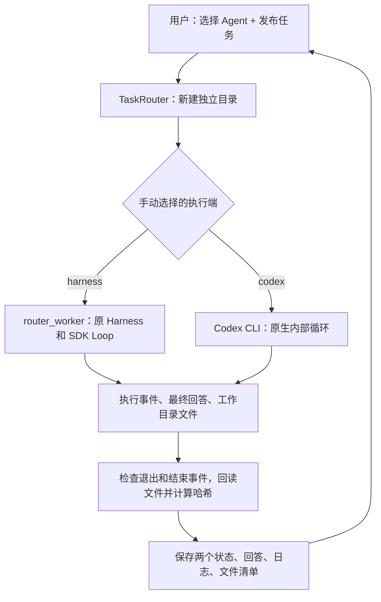

# 任务入口：选择 Agent，收回回答和文件

第一版接入两个执行端：现有 DeepSeek + Vercel Harness，以及本机已登录的 Codex CLI。你手动选择执行端，每次创建新的任务目录，入口等待执行结束后留下回答、过程日志和文件清单。

统一对话与并发任务管理使用 [person agent 任务中心](TASK_CENTER.md)：`npm run person`。本文的 `router` 命令仍是手动选择并等待单项执行的底层接口。前一版主模型单次委派保留为 `npm run person:delegate`，见 [说明](PERSON_AGENT.md)。

借鉴 [agent-router](https://github.com/nidhi-singh02/agent-router) 的注册执行端、交接任务、独立记录方式；本版先用手动选择和直接启动 CLI，不需要其 TypeSafe 路由服务或 Herdr 窗口管理。Codex 使用官方的 [非交互模式](https://learn.chatgpt.com/docs/non-interactive-mode)：`exec --json` 提供执行事件，`--output-last-message` 保存回答，`--sandbox workspace-write` 约束文件写入。

## 运行

在项目根目录先进入 SDK 目录：

```sh
cd vercel_agent
npm run router -- agents
npm run router -- run --agent codex "用程序计算 (123 * 456) + 789，生成 result.json 和中文 report.md。" --expect result.json --expect report.md
npm run router -- run --agent harness --skill calculation-audit "计算 (123 * 456) + 789，展示两步工具结果。" --expect result.md
npm run router -- runs --limit 10
```

`agents` 和 `runs` 不调用模型。Codex 复用本机 CLI 登录和模型配置；Harness 在独立进程中读取项目 `.env` 的 DeepSeek 配置。两者各自产生原有的模型用量。没有新增依赖，沿用现有 Node.js 22+、Python 虚拟环境和 npm 依赖。

长任务可写在文字文件中，再用 `--task-file /绝对路径/task.txt` 代替命令里的任务文字。`--expect` 可重复指定相对文件路径，如 `notes/summary.md`；检查文件确实存在且属于工作目录，不自动检查其语义。`--timeout 300` 是执行进程的超时，按 Ctrl+C 取消任务；两者都终止任务进程组，并收录已生成的部分文件。

供工具调用时用 `--task-file -` 从 stdin 读取任务，`--json` 只输出结构化结果，不混入终端说明。已完成任务的执行状态、验收状态和产物仍按同一格式保存。

默认根目录是 `~/Documents/Agent-Runs`。可用 `--root /绝对路径/其他目录` 或环境变量 `MINIMAL_AGENT_TASK_ROOT` 改变。Codex 位置自动从 PATH 和当前 macOS App 的安装位置查找；需要时用环境变量 `MINIMAL_AGENT_CODEX_BIN` 指定可执行文件绝对路径。这两个入口变量从当前终端读取；路由器本身不加载项目 `.env`。

## 文件放在哪里

```text
~/Documents/Agent-Runs/
  codex/或harness/
    YYYY-MM-DD/                   按 Asia/Shanghai 日期
      <任务 UUID>/
        task.json                 任务、状态、用量、验收结论、文件清单
        prompt.txt                原始任务
        events.jsonl              执行端的结构化事件
        stderr.log                执行端错误输出
        answer.md                 汇总的最终回答或失败原因
        artifacts.json            文件相对路径、字节数、SHA-256、缺失文件
        last-message.txt          Codex 原生最终回答（Codex 任务）
        workspace/                本次独立工作目录和实际生成的文件
          report.md               Codex 按任务生成的文件（示例）
          result.json
          result.md               Harness 输出（Harness 任务）
          harness/<本次运行>/     Harness 原生记录与 Skill 快照
          webpage-snapshots/      Harness 阅读产生的原文快照（如果有）
          obsidian/               本次博客保存的 Obsidian vault（如果有）
```

文件直接生成在 `workspace` 内，入口核对文件并建立清单；不根据模型口头报出的路径去读取外部文件。符号链接、特殊文件、`.git`、`node_modules`、`.venv`、`__pycache__` 不收录，原因留下记录。每个任务使用新 UUID，不覆盖同一天的其他任务。

独立工作目录是任务产物的边界。Codex 另启用其原生 workspace-write 沙箱；Harness 仍依赖原有工具的路径校验。这不是创建了容器或虚拟机。Codex 保留自己的全局配置与工具，本项目的八个工具只属于 Harness。

博客任务同样可以经由此入口执行：

```sh
npm run router -- run --agent harness --skill obsidian-blog-reader "读取 https://www.anthropic.com/engineering/managed-agents ，简化实际读取的内容、提炼一个 Agent 启发并保存。" --expect result.md
```

路由任务把网页快照和可选 Obsidian vault 放在自己的工作目录，便于按 Agent、日期收回文件。可在 Obsidian 中打开本次 `workspace/obsidian`；后续提取、合并笔记尚未加入。这个新入口使用新的快照存储，不能直接回查旧项目目录里的 document_id。原来的 `npm run harness -- obsidian-blog-reader ...` 仍使用原来配置的共享 vault 和快照存储。

## 怎样判断完成

`status` 记录执行过程：初始 `queued` → `running` → `completed`、`failed`、`timed_out` 或 `cancelled`。`queued` 只是开始执行前的状态；这一版没有后台调度队列。

只有进程退出码为 0、事件协议正确、执行端报告结束且有完整回答，才能得到 `completed`。预算停止、非零退出、缺少 `turn.completed`、错误事件和空回答不能冒充完成。

`task_verdict` 单独记录验收：

| 结论 | 含义 |
| --- | --- |
| `needs_review` | 执行完成，现有自动检查未发现问题；内容仍需验收 |
| `failed_checks` | 缺少期望文件，或者 Harness 原生自动检查失败 |
| `not_completed` | 执行失败、取消或超时 |

终端退出码为 0 表示运行结束且没有已知检查失败，2 表示检查失败，1 表示运行未完成或入口参数错误。`task.json` 保留明确的两个状态，不把“有回答”当作“任务正确”。

入口超时没有替换 Harness 原有的模型次数、工具次数、上下文或时间预算；Codex 使用自己的内部循环和配置。目前没有统一两端的 token 硬上限，用量格式也分别保存，不据此宣称模型之间的性能差异。本文的router命令不自动选择路线；任务中心另行支持后台队列和自动路由，详见TASK_CENTER.md。尚未接管已有聊天、恢复会话、定时任务或接入其他CLI。

## 阅读代码

按下面顺序阅读，可以把“任务管理”和“模型内部循环”分开理解：

1. `router_cli.ts`：用户选择 Agent、任务及期望文件；显示结果和目录。
2. `task_router.ts` 的 `TaskRouter.run()`：校验输入 → 建立任务目录 → 启动适配器 → 等待进程 → 判断执行状态 → 回读文件建立清单 → 保存记录。
3. `task_adapters.ts`：把统一任务转换为两种执行端的启动参数，并将各自事件转成 `AdapterOutcome`。新执行端需要这里的适配器和注册名称，不需要改模型循环。
4. `router_worker.ts`：现有 Harness 的独立进程入口，给它本次工作目录，沿用原来的 Skill、工具、预算和上下文策略。
5. `agent.ts`：模型与工具之间的原有循环；新增入口没有重写这层。



本地协议测试使用假 CLI，不调用模型。
