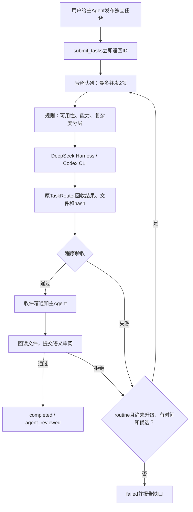

# person agent：独立任务的并发分配中心

复用现有 Harness、Vercel Loop、Python 工具桥接和 TaskRouter。用户向 DeepSeek 主 Agent 发布任务；主 Agent 提出能力、复杂度和验收，调度器选择已注册执行端，最多同时执行两项互不依赖的任务，完成后收消息、回读产物并审阅。

没有新增项目依赖。借鉴 agent-router 的候选筛选与路由分层，没有安装 TypeSafe 或 Herdr。

Codex可用性预检只确认CLI可执行文件存在；登录、额度或服务故障仍可能使实际任务失败，不能把注册成功当作执行成功。

## 运行

在项目根目录：

```sh
cd vercel_agent
npm run person
```

任务执行时仍可继续输入；主 Agent 的决策串行，工作进程后台并发。普通聊天可以直接回答。

- `/tasks`：本地查看状态，不请求模型。
- `/cancel <完整任务ID>`：取消指定任务，不请求模型、不升级。
- `/exit` 或 Ctrl+C：关闭中心，取消活动进程，保留已生成文件。

一次发布并等待回收：

```sh
npm run person -- "同时处理两个独立任务：用计算工具求12乘13；让具备代码执行能力的Agent编写并运行JSON转CSV脚本。分别回读审阅，给出结果和实际文件路径。"
```

项目 .env 提供 DeepSeek 配置，Codex 复用现有登录和默认模型。旧单次委派入口保留为 `npm run person:delegate -- "交给Codex执行，然后回读"`，见 [PERSON_AGENT.md](PERSON_AGENT.md)。原 router、chat、普通 harness 入口保留。

## 流程



同一逻辑任务最多两次执行：routine 首次失败可按配置升级一次到 advanced。高级候选初次失败、第二次失败、取消、时间不足或没有候选时结束。升级交接原目标、失败原因、首次回答和产物索引，保留两次独立记录，不更改验收预期。

`awaiting_review` 尚未完成。`completed / agent_reviewed` 表示程序检查与主模型审阅结束，用户仍能复核；它不是事实正确的保证。执行进程自己的 `completed / needs_review` 状态另外保留。

## 五个工具

| 工具 | 作用 |
| --- | --- |
| submit_tasks | 每次提交1–4项独立任务；相同key和参数复用，变更参数用新key |
| get_task_updates | 按递增cursor消费消息；提供task_id回查完整目标、验收、各attempt、文件和用量 |
| read_task_artifact | 按task_id、attempt_id和相对路径回读产物，核对hash，支持字符分页 |
| review_task | 先实际回读期望文件，再通过/拒绝及说明理由；证据须在已读范围内 |
| cancel_task | 取消本中心创建的任务，终止进程树，其他独立任务继续 |

主 Agent 只暴露五个调度工具，执行端保留原业务工具。IPC地址、凭据和中心工具不传给执行端，防止递归分发。只管理本中心创建的任务，不接管已有窗口或其他会话。

## 路由、验收和用量

`executorProfiles()` 当前注册 deepseek（routine、原工具库）和 codex（advanced、本机CLI）。`selectExecutor()` 先筛可用且能力匹配的候选，再按主模型的复杂度建议分层；复杂或coding优先advanced，其他优先routine。用户指定注册路线时验证后遵循。分层不是价格或成功率保证，不会修改执行端全局模型配置。

增加执行端需注册原 AgentAdapter 和一个profile；AgentId类型不再限制两个固定名称。没有自动发现所有已安装Agent、模型价目表或金额硬上限。

程序验收检查退出/结束事件、非空回答、原执行端检查、非空期望文件；可附回答/文件包含字符串和JSON Pointer精确值。JSON比较保留类型、忽略对象键顺序。预期必须源于用户要求或核实资料，不能倒填执行结果。默认result.md存在检查不能证明业务结果正确。

主模型审阅前必须回读至少一份期望产物。单文件最多1MiB、UTF-8、每次最多6000 Unicode字符，不跟随符号链接并核对hash。文件改变时不能沿用原收据验收。hash正确、逐字证据存在不保证解释正确；读了部分也不能声称全文已读。

父模型、DeepSeek执行轮、Codex原生用量分别保存；不能把缓存输入再加到input_tokens上。Codex内部请求/tokens不受父模型次数上限控制。

## 消息、上下文与限额

普通工作进度只落盘，不触发模型。完成、失败、取消通知按任务合并，再唤醒同一个DeepSeek主入口；用户新消息可排队。主入口最多保留四轮近期对话预览，每条输入/回答各500字符；完整对话存conversation.jsonl，原目标、验收和产物按任务ID完整回查。精确约束不能依赖预览。

主循环内部沿用legacy压缩，新增任务/执行ID、文件hash、回读位置的保留规则。主profile触发/目标为40000/28000估算tokens，安全容量64000；其他入口保留原配置。

- 每中心：最多8项逻辑任务、并发2项、12个主决策轮、900秒。
- 每任务：最多2次执行，默认360秒总时限（含排队/审阅），可1–600秒；每个执行进程最多180秒且受剩余时限缩短。
- 主模型每轮：8步、12总请求、16工具、180秒、2048输出tokens。
- DeepSeek执行端：原5步、8总请求/工具、90秒；输出改为1024。

这些是初版边界，未证明最佳性价比。预算耗尽保留结果、报告缺口；不能称全部完成。

## 文件与阅读顺序

```text
~/Documents/Agent-Runs/center/<日期>/<中心UUID>/
  session.json                    候选与限额
  events.jsonl                    带sequence的中心收件箱
  conversation.jsonl              完整输入/主回复（自动通知另标记）
  tasks/<逻辑任务ID>/task.json      原目标、验收、执行、检查、回读与审阅
  executions/<agent>/<日期>/<ID>/  原路由器执行记录和实际工作目录
  main-agent/<本轮Harness>/        主模型请求和工具记录
  summary.json                    汇总，保留关闭前状态
```

本地IPC使用0700临时目录、0600 Unix socket、随机token，不开HTTP端口。当前支持本项目macOS/Linux方式。关闭清理IPC与活动进程，产物保留；重启新建中心，没有崩溃恢复、重新连接或后台常驻。交互输入结束即关闭；批量模式等待执行和审阅流程结束。

阅读顺序：

1. skills/task-coordinator/SKILL.md：主Agent分配、回收和停止规则。
2. person_cli.ts、center_conversation.ts：对话与事件唤醒。
3. task_center.ts：submit → pump → executeAttempt → failOrUpgrade → read/review/cancel。
4. task_center_server.ts、tool_library/task_center.py、tools.py：IPC与工具Schema。
5. task_router.ts、task_adapters.ts：原执行过程、事件观察和凭据隔离。
6. 原agent.ts：SDK仍处理模型和工具的循环。

离线和真实验收见 [任务中心验收](../reports/task-center-validation.md)。
